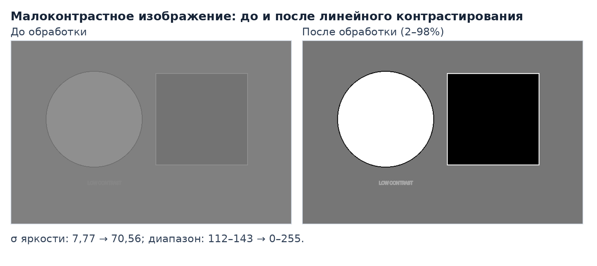
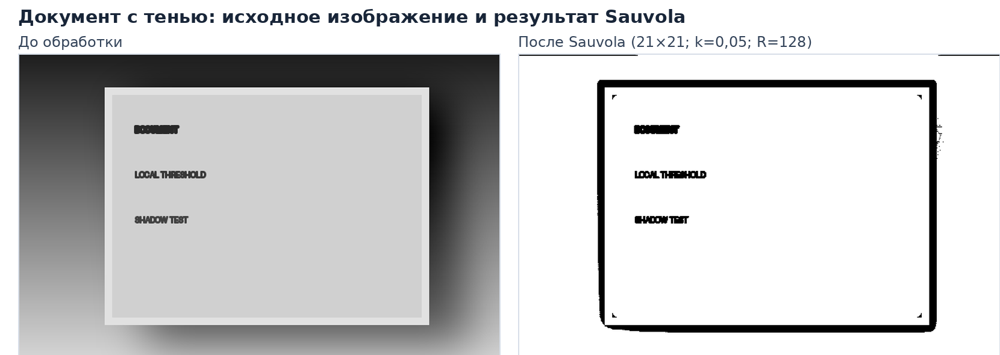
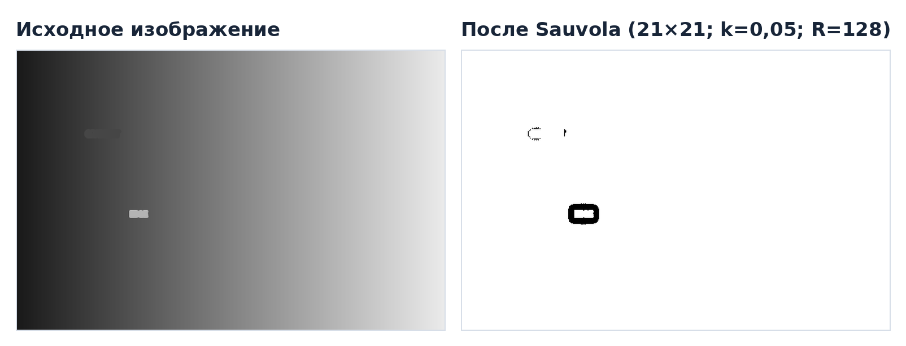
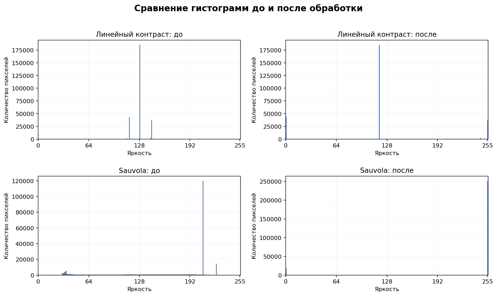

# Отчёт по лабораторной работе № 3

## Основы обработки цифровых изображений

**Студент:** Никончук Андрей Андреевич  
**Подгруппа:** 11Б  
**Вариант:** 11

## 1. Цель и содержание варианта

Цель работы — реализовать методы обработки цифровых изображений и проверить их действие на изображениях с различными свойствами.

Согласно таблице вариантов, вариант 11 включает локальную пороговую обработку двумя методами на выбор и адаптивную пороговую обработку. В выбранном столбце также указана поэлементная обработка с линейным контрастированием. Поэтому в качестве основных методов реализованы:

- линейное контрастирование;
- локальный порог по среднему значению окна;
- локальный метод Niblack;
- адаптивный метод Sauvola.

В качестве дополнительных режимов добавлены метод Оцу и CLAHE. Они не заменяют методы варианта, а используются для дополнительного сравнения.

## 2. Используемые алгоритмы

Перед обработкой цветное изображение преобразуется в массив яркостей:

`Y = 0,299R + 0,587G + 0,114B`.

**Линейное контрастирование.** По гистограмме определяются нижний и верхний процентили (по умолчанию 2% и 98%). Значения между ними растягиваются на диапазон 0–255, значения за границами ограничиваются:

`g = clamp(255 · (f − a) / (b − a))`.

**Локальный порог по среднему.** Для каждого пикселя рассчитывается средняя яркость окна 21×21. Пиксель становится белым, если его яркость выше среднего значения окна, иначе — чёрным:

`T(x,y) = μ(x,y)`.

**Niblack.** Порог зависит от локального среднего и стандартного отклонения:

`T(x,y) = μ(x,y) + kσ(x,y)`.

В экспериментах использовано `k = −0,20`.

**Sauvola.** Адаптивный порог рассчитывается по локальному среднему и стандартному отклонению:

`T(x,y) = μ(x,y) · (1 + k(σ(x,y)/R − 1))`.

Для приведённых результатов использованы окно 21×21, `k = 0,05` и `R = 128`. Значение `k` выбрано экспериментально для тестового набора; его можно менять в интерфейсе.

## 3. Организация обработки

Приложение разделено на три логические части:

1. **Интерфейс:** загрузка тестового или собственного изображения, выбор метода и параметров, просмотр результата и гистограмм.
2. **Доступ к пикселям:** изображение после декодирования браузером помещается в типизированный массив RGBA, затем рассчитывается массив яркости. Для отображения результата формируется новый массив RGBA.
3. **Алгоритмы:** математические функции работают с массивами интенсивностей и не зависят от интерфейса.

Локальные методы используют интегральное изображение (SAT) и интегральное изображение квадратов. Поэтому сумма и сумма квадратов в прямоугольном окне вычисляются по четырём значениям SAT. После построения интегральных массивов локальная статистика одного окна рассчитывается за O(1), а построение SAT выполняется за O(W·H).

Для обработки границ доступны две стратегии: **Reflect** (зеркальное отражение) и **Clamp** (дублирование ближайшего граничного пикселя). В тестах проверено, что обработка полос с дополнительной гало-областью даёт тот же результат, что и обработка целого изображения, для методов local mean, Niblack и Sauvola при обеих стратегиях границ.

Вычисления выполняются в Web Worker. Для локальных методов на больших изображениях (от 1,2 млн пикселей) изображение делится на горизонтальные полосы и обрабатывается несколькими Worker-потоками. На границах полос используется дополнительная область радиуса окна, чтобы не терять соседние пиксели.

## 4. Тестовая база и параметры

В проект включены восемь тестовых изображений размером 640×420 пикселей (268 800 пикселей каждое):

| Файл | Особенность изображения |
|---|---|
| `shadow_document.png` | документ на фоне выраженной тени |
| `uneven_lighting.png` | неравномерное освещение |
| `low_contrast.png` | малый диапазон яркостей |
| `noise.png` | шумовое изображение |
| `blurred_text.png` | размытые надписи |
| `texture.png` | текстурный фон и геометрические объекты |
| `gradient.png` | плавный градиент яркости и небольшие объекты |
| `night_sign.png` | тёмная сцена с контрастными элементами |

Для сравнения методов использовались одинаковые размеры локального окна и фиксированные параметры, указанные в разделе 2. Все численные показатели ниже рассчитаны непосредственно по массивам пикселей исходных файлов и результатов алгоритмов проекта.

## 5. Эксперименты и полученные результаты

### 5.1. Линейное контрастирование малоконтрастного изображения

Для `low_contrast.png` исходная яркость находилась в диапазоне 112–143, стандартное отклонение составляло 7,77. После линейного контрастирования диапазон стал 0–255, а стандартное отклонение увеличилось до 70,56. Таким образом, разброс яркостей вырос примерно в 9,1 раза. На изображении после обработки границы круга и прямоугольника стали заметнее.

*Рисунок 1 — Малоконтрастное изображение до и после линейного контрастирования.*

### 5.2. Сравнение локальных методов на документе с тенью

Для `shadow_document.png` сравнивались локальное среднее, Niblack и Sauvola при окне 21×21. По визуальному результату Sauvola лучше сохранил светлую область листа и отделил тёмные надписи от фона. У локального среднего и Niblack большая часть области тени и границы листа попала в чёрный класс.

| Метод | Доля чёрных пикселей в результате |
|---|---:|
| Локальное среднее | 67,20% |
| Niblack (`k = −0,20`) | 50,68% |
| Sauvola (`k = 0,05`) | 6,50% |

Доля чёрных пикселей — это характеристика распределения двух классов, а не самостоятельная оценка точности. Вывод о качестве сделан по совокупности чисел и визуального сравнения результата с исходным изображением.

*Рисунок 2 — Документ с тенью до обработки и после применения Sauvola; количественное сравнение с локальным средним и Niblack приведено в таблице.*

### 5.3. Адаптивная обработка градиентного фона

На изображении `gradient.png` фон плавно меняет яркость слева направо. При локальном среднем доля чёрных пикселей составила 62,79%, при Niblack — 4,45%, при Sauvola — 0,39%. На результате Sauvola общий градиент фона в основном стал белым, а небольшие тёмные элементы сохранились. Это показывает, что адаптивный порог учитывает локальные изменения яркости лучше фиксированного глобального порога, хотя результат зависит от выбранных параметров.

*Рисунок 3 — Градиентный фон до и после адаптивной обработки Sauvola.*

## 6. Анализ гистограмм

Для линейного контрастирования гистограмма исходного малоконтрастного изображения сосредоточена в узком диапазоне около среднего уровня яркости. После преобразования она занимает более широкий диапазон, а крайние процентили переходят к значениям 0 и 255. Это согласуется с ростом стандартного отклонения с 7,77 до 70,56.

После Sauvola результат является бинарным, поэтому гистограмма концентрируется у двух значений — 0 и 255. Для документа с тенью доля белых пикселей составила 93,50%, а чёрных — 6,50%, что соответствует преимущественно светлой области листа с тёмными надписями и границами.

*Рисунок 4 — Гистограммы до и после линейного контрастирования и адаптивного порога Sauvola.*

## 7. Проверка реализации и ограничения

Для алгоритмов выполнены автоматические проверки. В Node.js успешно прошли 18 проверок, включая сравнение результата обработки целого изображения и отдельных полос для трёх локальных/адаптивных методов и двух вариантов обработки границ. Дополнительные режимы Оцу и CLAHE также проверяются на тестовых массивах.

В тестах использованы синтетические изображения, а не фотографии с эталонной разметкой. Поэтому численные доли чёрных и белых пикселей характеризуют полученное распределение, но не являются показателями precision/recall. Для шумных, текстурных и сильно размытых изображений один только пороговый метод не устраняет все дефекты: результат зависит от размера окна и параметров `k` и `R`.

## 8. Вывод

В ходе работы создано веб-приложение для методов варианта 11: линейного контрастирования, локального порога по среднему, Niblack и адаптивного порога Sauvola. Результаты проверены на восьми изображениях размером 640×420 пикселей, а выводы подтверждены изображениями до/после, численными характеристиками яркости и гистограммами.

Эксперимент с малоконтрастным изображением показал, что линейное контрастирование расширило диапазон яркости с 112–143 до 0–255 и увеличило стандартное отклонение с 7,77 до 70,56. На документе с тенью Sauvola дал визуально более чистое разделение листа и надписей: чёрный класс занял 6,50% пикселей, тогда как у локального среднего — 67,20%, а у Niblack — 50,68%. На градиентном изображении Sauvola также устранил большую часть плавного фона, сохранив небольшие тёмные элементы.

Полученные результаты показывают, что один пороговый метод не является лучшим для всех изображений. Локальное среднее проще, Niblack сильнее реагирует на локальный разброс яркости, а Sauvola оказался наиболее подходящим для тестов с тенью и плавным градиентом при выбранных параметрах. Для другого изображения параметры окна и коэффициенты необходимо подбирать отдельно. Применение SAT уменьшает стоимость вычисления локальной статистики, Reflect и Clamp обеспечивают корректную обработку границ, а Web Worker и параллельная обработка полос позволяют вынести вычисления из основного потока интерфейса.

## Источник

Методические указания к лабораторной работе № 3 «Основы обработки цифровых изображений», 4 страницы.
